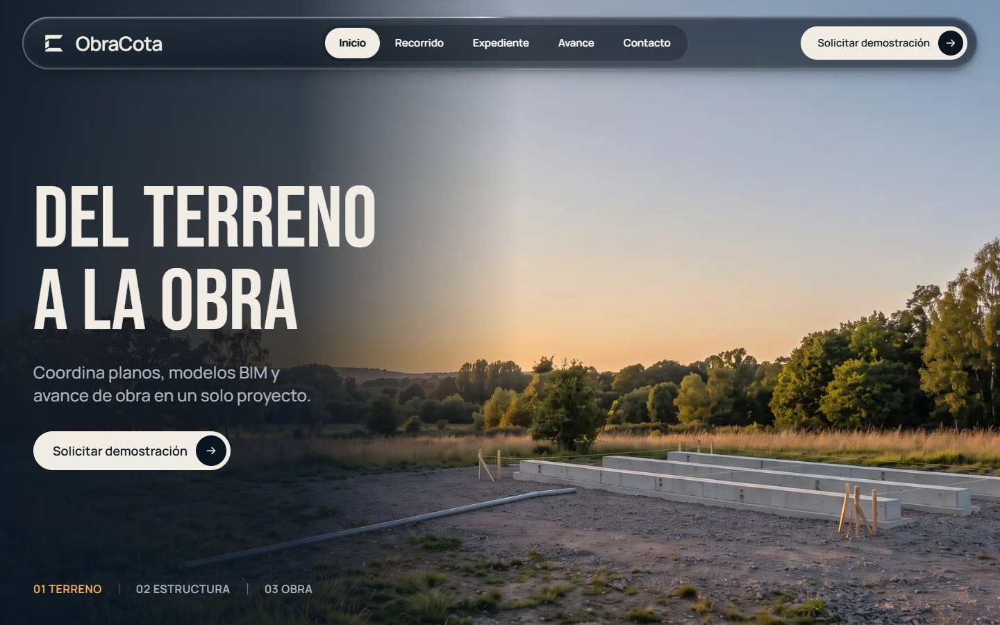
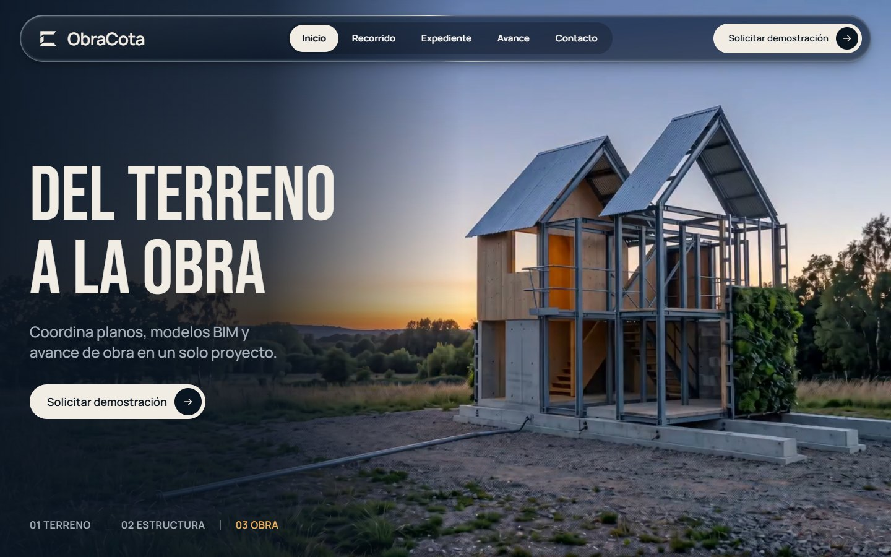
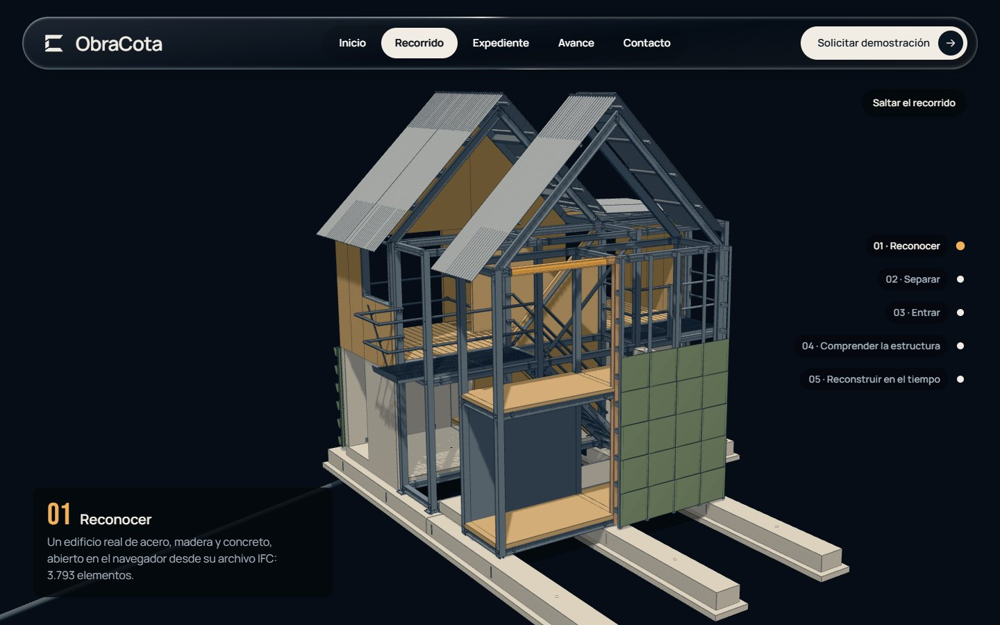
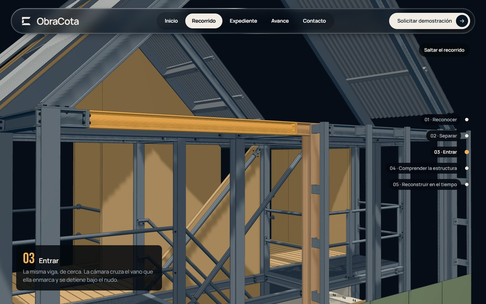
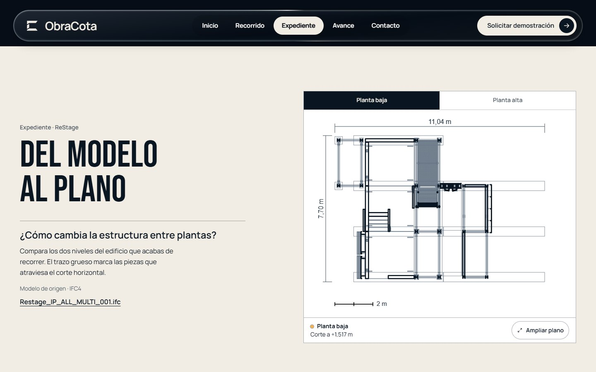
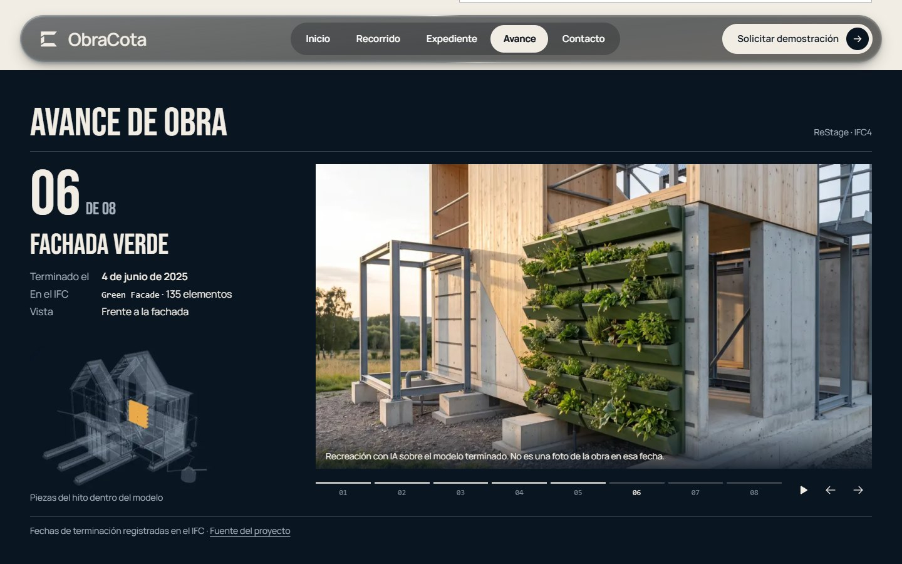
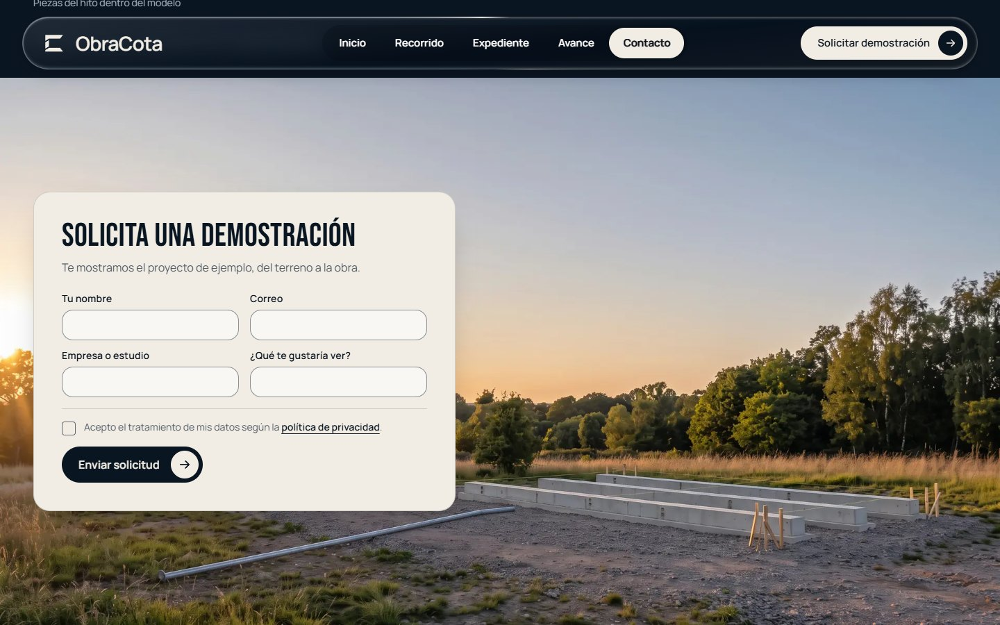

<div align="center">


# ObraCota

**Del terreno a la obra.** Planos, modelos BIM y avance de obra en un solo proyecto.

[Vista general](#vista-general) · [Qué incluye](#qué-incluye) · [Puesta en marcha](#puesta-en-marcha) · [Docker](#despliegue-con-docker) · [Estructura](#estructura-del-repositorio) · [Datos y créditos](#datos-y-créditos)



</div>

ObraCota es una plataforma para ingenieros y diseñadores que coordinan planos, modelos BIM y avance de obra en Colombia. El repositorio contiene la landing pública, el panel de proyectos, la API y el motor IFC. El panel permite abrir un modelo, proponer un cambio de tipo de puerta, revisar el costo estimado y recorrer las revisiones del IFC en primera persona.

> [!NOTE]
> ObraCota es un proyecto académico en fase de definición. El formulario valida y confirma, pero no envía datos. El edificio del recorrido 3D sí es real: es el demostrador ReStage de RWTH Aachen, publicado como dato abierto.

## Vista general

| Portada ligada al scroll | Recorrido 3D del modelo |
|---|---|
|  |  |
| **Detalle dentro del modelo** | **Expediente: del modelo al plano** |
|  |  |
| **Avance de obra** | **Contacto** |
|  |  |

## Qué incluye

- **Portada que construye el edificio.** Al bajar, la imagen pasa del terreno a la estructura y a la obra terminada. El vídeo sigue al scroll y cada parada cae sobre una foto nítida.
- **Entrada por la letra.** La frase «Un detalle cambia en el plano» se amplía hasta cruzar la «O» y deja al visitante dentro del modelo.
- **Recorrido 3D guiado.** Cinco tramos sobre el modelo real: reconocer, separar por plantas, entrar, comprender la estructura y reconstruir en el tiempo con los hitos del archivo IFC.
- **Expediente.** Plantas del edificio obtenidas del mismo IFC, con cota de corte y ampliación.
- **Avance de obra.** Carrusel automático con los ocho hitos que el IFC registra como terminados: fecha, nombre original, número de piezas y su ubicación dentro del edificio.
- **Contacto.** Formulario accesible con validación y mensajes de error por campo.

La página respeta `prefers-reduced-motion`: sin movimiento no hay recorridos fijados ni reproducción automática, y todo el contenido sigue disponible.

## Tecnologías

| Para qué | Con qué |
|---|---|
| Aplicación | Next.js 16 (App Router, Turbopack), React 19, TypeScript |
| Estilos | Tailwind CSS 4, shadcn/ui sobre Base UI, iconos Phosphor |
| Movimiento | Lenis para el scroll suave, GSAP 3 con ScrollTrigger |
| Modelo 3D | three.js en el navegador; `web-ifc` y glTF-Transform para convertir el IFC |
| Pruebas | Playwright en escritorio y móvil |

## Puesta en marcha

Requisitos: Node.js 22 o posterior y, para las pruebas, Microsoft Edge instalado.

```bash
git clone https://github.com/Dvanielx03/ObraCota.git
```

```bash
cd ObraCota/landing
```

```bash
npm install
```

```bash
npm run dev
```

La página queda en `http://localhost:3000`.

| Comando | Qué hace |
|---|---|
| `npm run dev` | Servidor de desarrollo |
| `npm run build` | Compilación de producción |
| `npm run test:e2e` | Compila, sirve el sitio y lo recorre con Playwright |
| `node scripts/capturas-readme.mjs <url>` | Regenera las capturas de este documento |

> [!TIP]
> Para probar un servidor que ya está abierto, sin compilar: `SITIO_EN_MARCHA=http://localhost:3000 npx playwright test`.

## Despliegue con Docker

Con Docker Desktop en marcha, copia `.env.example` como `.env`. Define una contraseña de PostgreSQL y una clave JWT independiente de al menos 32 bytes aleatorios en Base64. Puedes generar cada valor con `openssl rand -base64 48`. Conserva el archivo local entre despliegues. Para HTTPS configura `COOKIE_SECURE=true`.

```bash
docker compose up -d --build --wait
```

La landing queda en `http://localhost:3200`. «Entrar al panel» abre la aplicación en `http://localhost:3201`. En Windows, `.\desplegar.ps1` levanta ambos servicios.

| Comando | Qué hace |
|---|---|
| `docker compose up -d --build --wait` | Levanta landing, panel, API, PostgreSQL y el motor privado IfcOpenShell |
| `docker compose ps` | Comprueba la salud de los cinco servicios |
| `docker compose logs -f landing` | Muestra los registros |
| `docker compose down` | Detiene los contenedores; los datos se conservan |

Para cambiar los orígenes públicos, configura `SITE_URL` y `PANEL_URL` en el archivo local `.env` y reconstruye las imágenes. Ambos enlaces se fijan en la compilación. En desarrollo sin Compose las variables son `NEXT_PUBLIC_PANEL_URL` en la landing y `NEXT_PUBLIC_SITE_URL` en la aplicación.

## Probar un cambio IFC

1. Entra al panel, crea un proyecto y guarda el IFC desde **Archivos y versiones**.
2. Abre la versión con **Prisma**, selecciona una puerta y pulsa **Proponer cambio IFC**. Elige un tipo del mismo archivo y usa una captura del visor o un PNG como referencia visual.
3. Introduce precios y sus fuentes si dispones de ellos. Revisa las medidas y los avisos. Registra la propuesta, abre **Cambios de diseño** y decide si aplicarla.
4. Abre la nueva versión. Pulsa **Recorrer**, elige un punto libre en el piso y alterna **Anterior** y **Nueva**. Si quieres restaurar el original, vuelve a **Cambios de diseño** y crea una revisión de restauración.

El motor solo aplica tipos de puerta con representación verificable y medidas nominales compatibles con el hueco actual. Los avisos son informativos. El flujo admite una referencia visual local y funciona sin llamar a un proveedor de IA. Consulta el alcance técnico en la [arquitectura](backend/docs/ARCHITECTURE.md).

> [!NOTE]
> La imagen usa el modo `standalone` de Next.js: solo lleva el servidor, los archivos estáticos y `public/`. La API de proyectos se documenta en [la arquitectura del backend](backend/docs/ARCHITECTURE.md) y [el mapa de contextos](backend/docs/CONTEXT-MAP.md).

## Estructura del repositorio

```
landing/
  src/app/                    páginas, metadatos y sistema visual (globals.css)
  src/components/site/        cabecera, pie, marca y scroll suave
  src/components/sections/    portada, recorrido 3D, expediente, avance y contacto
  src/lib/modelo/             ficha del modelo, fuente y licencia
  public/                     imágenes, vídeo y modelo convertido (GLB)
  scripts/                    conversión de IFC a GLB, plantas, vídeo y capturas
  tests/                      pruebas de extremo a extremo
docs/capturas/                capturas usadas en este documento
```

El detalle técnico (coreografía del recorrido, conversión del IFC, decisiones de rendimiento y pendientes) está en [landing/README.md](landing/README.md).

## Datos y créditos

- **Modelo 3D, plantas e hitos.** ReStage, demostrador construido en el campus Melaten de RWTH Aachen, publicado en [Zenodo](https://zenodo.org/records/21470658) con licencia [CC BY 4.0](https://creativecommons.org/licenses/by/4.0/). Se convirtió de IFC a GLB, se omitió el entorno del campus y los colores son de ObraCota. Las fechas que muestra la página son las de terminación registradas en el archivo; no se interpola ninguna.
- **Imágenes de la portada y del avance.** Son recreaciones hechas con IA a partir de capturas de ese mismo modelo, con la misma cámara. Muestran el edificio terminado; no son fotografías de la obra. La sección de avance lo indica junto a cada imagen.

> [!IMPORTANT]
> El archivo IFC original (190 MB) no se incluye en el repositorio. Para regenerar el modelo hay que descargarlo de Zenodo y seguir los pasos de [landing/README.md](landing/README.md).
